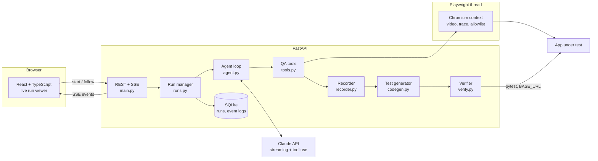

# QAPilot — Autonomous QA Agent

> Give it a URL and a user story. An AI QA engineer explores the app in a real browser, files evidence-backed bug
> reports, and leaves behind a Playwright suite that proves every bug it found.

QAPilot is a full-stack agentic application built on **Claude** with tool use. Claude drives a sandboxed **Chromium**
through **Playwright**, the way a senior tester would. It plans scenarios from the story, clicks and types its way
through them, asserts what *should* happen, and digs into console errors and failed requests. It does not just
describe bugs. Every scenario it runs becomes a regression test in Python and TypeScript. That suite is then replayed
headless to show each bug reproduces. If you supply a known-good build, the suite also runs there to show the tests
pass on it.


-0d0d0d)

---

## Features

- **Agentic exploration in a real browser.** Claude reads each page as an accessibility outline with element refs.
  It works through the story in scenarios, each with fresh storage. Its tools:
  - **Scenarios and navigation:** `begin_scenario`, `navigate`.
  - **Interaction:** `click`, `fill`, `select_option`, `set_checked`, `press_key`, `hover`.
  - **Looking and checking:** `snapshot`, `screenshot`, `expect`, `inspect_network`.
  - **Wrapping up:** `report_bug`, `finish`.
- **Signals as leads.** Every action returns the console errors, uncaught exceptions, failed requests (HTTP ≥ 400),
  dialogs and blocked navigations it triggered, so the agent investigates what a human tester would notice.
- **Evidence-backed bug reports.** Each bug comes with:
  - severity, category and exact reproduction steps;
  - expected vs. actual behaviour;
  - an auto-attached screenshot;
  - the failing checks linked to it.
- **Generated regression suite.** Every scenario becomes one Playwright test, as `pytest` and `@playwright/test`
  files, using the locators the agent verified during the run.
  - Locators are role-based and resilient, chosen in Playwright's recommended order: test id, role + name, label,
    placeholder, text.
  - Assertions are soft and state the *correct* behaviour, so a test fails while its bug exists and turns green once
    it is fixed.
- **Verification, not claims.** The Python suite is replayed in a fresh browser.
  - A bug only counts as *reproduced* when its test fails again on the target.
  - With a control URL (a known-good build) the suite runs there too, where every test should pass.
- **Live run viewer.** The UI streams every step over SSE:
  - thinking summaries, narration, tool calls with their outcomes;
  - the browser's current frame and the signals;
  - per-test verification results as pytest reports them.
- **Recordings.** Each run stores:
  - a session video (`.webm`);
  - a Playwright trace (open it with `npx playwright show-trace` or at trace.playwright.dev);
  - a Markdown report;
  - `bugs.json`;
  - a downloadable `suite.zip`.
- **Persistent, resumable runs.** Runs and their full event logs are stored in SQLite. Reloading or reconnecting
  resumes the stream from the last event, and finished runs replay exactly as they streamed.
- **Cost transparency.** Each run shows model, steps, elapsed time, tokens (including prompt cache hits) and an
  estimated cost.

## Architecture



**One run, end to end.** `POST /api/runs` queues the run and `GET /api/runs/{id}/events` follows it. It goes
through four phases, each reported on the stream:

1. **Explore.** The agent sends the story, the tool definitions and the conversation to Claude using streaming.
   Tool calls run against an isolated browser context. Each successful action and assertion is recorded as a test
   step, so the session itself becomes the suite.
2. **Generate.** The recorded scenarios become `test_qapilot.py` and `qapilot.spec.ts`. Their URLs are relative to
   `BASE_URL`, so the same suite runs against any build.
3. **Verify.** `pytest` replays the Python suite headless and streams each result. When the run has a control URL,
   it then replays against the control build.
4. **Report.** `report.md` and `bugs.json` are written, every bug gets its verdict, and the result is stored.

## Design decisions

| Concern | Decision |
|---|---|
| **Replayable locators** | The agent acts on snapshot refs (`e12`), which mean nothing outside the session. For every element it touches, `locators.py` derives the locator a careful engineer would write and keeps the first one that resolves to exactly that element. Duplicates such as one "Add to cart" per product card are scoped to their card. `nth` and a CSS path are last resorts. One spec renders to a live locator, Python source and TypeScript source, so the run and the test it leaves behind use the very same selector. |
| **Tests that prove bugs** | Checks assert the correct behaviour, never the buggy value observed. A test written for a bug must fail on the target ("reproduced") and should pass on the control build ("stable"). If it passes on the target, or fails on the control build, it is flagged instead of trusted. |
| **Browser sandbox** | Playwright runs on a dedicated thread with its own event loop (Proactor on Windows), so a slow page never stalls the API. Top-level navigation is restricted to the target's host plus an allowlist. Blocked attempts are surfaced as signals. Each run gets its own context, video and trace. |
| **Long sessions** | Dozens of page outlines and screenshots flow back as tool results. Server-side context editing (`clear_tool_uses`) clears the oldest ones once the prompt passes 50k tokens. It keeps scenario markers, bug reports and the most recent results, so the agent can explore for 60 steps without the context or the bill running away. Tools, system prompt and history are prompt-cached across steps. |
| **Tool input streaming** | Tool inputs stream eagerly, so the UI shows a call as it is being written. Because the API no longer validates them, `validate_input` checks each one against its schema before it runs. |
| **Robust stop reasons** | A possibly truncated tool call (`max_tokens`) is never executed; exploration stops with a clear error. `pause_turn` is resumed. `refusal` ends the run with a clear message. Broken streams are retried, and the timeline marks each retry. Requests opt into server-side refusal fallbacks (`QAPILOT_ENABLE_FALLBACKS`). |
| **Adaptive reasoning** | Adaptive thinking with summarised display and a configurable effort level (`low` … `max`) trades depth for latency and cost. |
| **Live and resumable streams** | Live events are kept in memory with a sequence number, so any number of viewers can follow a run. A reconnect with `Last-Event-ID` gets only what it missed. The frontend reducer is idempotent by sequence number. |
| **Demo mode** | Without an API key, the backend swaps Claude for `DemoLLM`, a scripted QA session behind the same `LLMClient` protocol. Only the decisions are scripted. Each playbook step reads refs from the latest real page outline, and a bug is reported only when a check actually failed. The browser, recordings, generated tests and verification all run for real. |
| **Testability** | The LLM sits behind a small protocol. Unit tests drive the agent loop, tools, code generation and HTTP API with fakes, so they need no network or API key. An `e2e` test runs the whole pipeline against the seeded shop in a real Chromium. |

## Quick start

### Option A: Docker (recommended)

```bash
cp .env.example .env        # then set ANTHROPIC_API_KEY (or leave it empty for demo mode)
docker compose up --build
```

Open <http://localhost:8080>, click **Use demo shop**, then **Start run**. The API and the demo shop are on
<http://localhost:8100>. If port 8080 is taken (for example by DataPilot), set `QAPILOT_WEB_PORT=8180` in `.env`.

### Demo mode (no API key, no cost)

Leave `ANTHROPIC_API_KEY` empty and the app starts in **demo mode**. A badge and banner appear in the UI, and a
scripted agent stands in for Claude. It still drives a real Chromium through the bundled demo shop, records evidence,
generates both suites and verifies them on both builds. A full demo run takes two to three minutes. It finds
the shop's 7 seeded bugs, with every one reproduced on `/shop/` and every test passing on `/shop-fixed/`.

Set `QAPILOT_DEMO_MODE=true` to force demo mode even when a key is configured (useful for a public portfolio
deployment), or `false` to disable it.

### Option B: Local development

Prerequisites: Python 3.11+ and Node 20+.

```bash
# Backend
cd backend
python -m venv .venv
source .venv/bin/activate          # Windows: .venv\Scripts\activate
pip install -r requirements-dev.txt
python -m playwright install chromium
cp ../.env.example .env            # set ANTHROPIC_API_KEY, or leave empty for demo mode
uvicorn app.main:create_app --factory --port 8100 --reload
```

```bash
# Frontend (in a second terminal)
cd frontend
npm install
npm run dev
```

Open <http://localhost:5180>. The Vite dev server proxies `/api` to the backend on port 8100.

### Tests

```bash
cd backend && pytest -q && ruff check .      # unit + API tests, offline
cd backend && pytest -m e2e                  # full pipeline in a real Chromium (about 2 minutes)
cd frontend && npm test && npm run build
```

CI (`.github/workflows/ci.yml`) runs all three, plus a Docker build.

## Running a generated suite yourself

Download `suite.zip` from the **Tests** or **Report** tab. It contains both suites, `pytest.ini`,
`playwright.config.ts` and a README.

```bash
pip install pytest-playwright && playwright install chromium
BASE_URL=http://localhost:8100/shop/ pytest test_qapilot.py
```

```bash
npm i -D @playwright/test && npx playwright install chromium
BASE_URL=http://localhost:8100/shop/ npx playwright test
```

Point `BASE_URL` at a fixed build, such as `/shop-fixed/` or your staging deploy. Tests that failed because of a bug
should now pass.

## Configuration

All settings are environment variables. They can also go in `backend/.env`.

| Variable | Default | Description |
|---|---|---|
| `ANTHROPIC_API_KEY` | none | Enables exploration with Claude. Without it (and without `GEMINI_API_KEY`) the app runs in demo mode. |
| `QAPILOT_DEMO_MODE` | auto | `true`/`false` forces the scripted demo agent on or off. Unset = on only when no key is set. |
| `QAPILOT_MODEL` | `claude-opus-5-5` | Claude model used by the agent. |
| `QAPILOT_EFFORT` | `medium` | Reasoning effort: `low`, `medium`, `high`, `xhigh`, `max`. |
| `QAPILOT_MAX_AGENT_STEPS` | `60` | Step budget per run (a run can ask for fewer). |
| `QAPILOT_ENABLE_FALLBACKS` | `true` | Server-side refusal fallback to the recommended model. |
| `QAPILOT_PUBLIC_URL` | `http://localhost:8100` | Public origin of the API, used to build the demo-shop URLs. |
| `QAPILOT_ALLOWED_HOSTS` | `["localhost","127.0.0.1"]` | Hosts the browser may visit besides the target's own (JSON list). |
| `QAPILOT_MAX_CONCURRENT_RUNS` | `2` | Runs explored in parallel; the rest queue. |
| `QAPILOT_VERIFY_TIMEOUT_S` | `120` | Time limit for each suite replay. |
| `QAPILOT_RECORD_VIDEO` | `true` | Record a session video. |
| `QAPILOT_HEADLESS` | `true` | Set `false` to watch the browser locally. |
| `QAPILOT_DATA_DIR` | `backend/data` | Where runs, recordings and the SQLite store live (`/data` in Docker). |

## Other LLM providers (Gemini, Ollama)

Claude is the default and recommended provider. For a free setup, the agent can also run on **Google Gemini**
(free API tier) or a **local Ollama** model, through their OpenAI-compatible endpoints.

**How it fits in.** The agent loop only talks to the `LLMClient` protocol. `app/openai_compat.py` is a second
implementation of it, next to `ClaudeLLM` in `app/llm.py`, which is unchanged. Everything else is shared by every
provider: browser sandbox, tools, recorder, test generation, verification, report, UI and event stream. Run history
stays in the Anthropic message format.

**Choosing a provider.** With `QAPILOT_PROVIDER` unset, the backend picks automatically:

1. `ANTHROPIC_API_KEY` set: Claude, exactly as before.
2. Otherwise `GEMINI_API_KEY` set: Gemini.
3. Otherwise: demo mode.

Ollama needs no key, so it is only used when you ask for it with `QAPILOT_PROVIDER=ollama`.

```bash
# Gemini: create a free key at https://aistudio.google.com/apikey
GEMINI_API_KEY=your-key

# Ollama: install from https://ollama.com, then
ollama pull qwen3:14b
OLLAMA_CONTEXT_LENGTH=32768 ollama serve
QAPILOT_PROVIDER=ollama
```

| Variable | Default | Description |
|---|---|---|
| `QAPILOT_PROVIDER` | auto | `claude`, `gemini` or `ollama`. Unset = the order above. |
| `GEMINI_API_KEY` | none | Google AI Studio key. |
| `QAPILOT_GEMINI_MODEL` | `gemini-3.5-flash-lite` | Any Gemini model with function calling and image input. |
| `QAPILOT_OLLAMA_BASE_URL` | `http://localhost:11434/v1` | In Docker Compose it defaults to `http://host.docker.internal:11434/v1`. |
| `QAPILOT_OLLAMA_MODEL` | `qwen3:14b` | Pick a model with tool-calling support. Larger models explore much better. |
| `QAPILOT_COMPAT_VISION` | auto | Send screenshots as images. Unset = on for Gemini, off for Ollama. Turn it on for a vision model such as `qwen2.5vl`. |
| `QAPILOT_COMPAT_CONTEXT_TOKENS` | `50000` | Estimated prompt size at which old tool results are cleared. |
| `QAPILOT_COMPAT_KEEP_TOOL_RESULTS` | `6` | Newest tool results that are never cleared. |
| `QAPILOT_COMPAT_TIMEOUT_S` | `300` | Read timeout. Local models can be slow. |

`/api/health` and `/api/config` report the active `provider` and `model`.

**Free-tier quota.** Google counts the Gemini free tier per model and per project, and some models allow only about 20
requests a day. Each agent step is one request, so a run uses roughly as many requests as its max steps. The default
`gemini-3.5-flash-lite` allowed more daily requests than `gemini-3.5-flash` in testing; for a quick check, use 20-30
max steps. When a run hits
the daily quota, exploration stops with a `429`, and the pipeline still generates, verifies and reports what it found.

**What the adapter does on the client side.** These replace Claude features that the OpenAI-compatible API lacks:

- **Context editing.** Claude clears old tool results on the server (`CONTEXT_MANAGEMENT` in `llm.py`). The adapter
  does the same before each request. Once the estimated prompt passes the threshold, it clears the oldest page
  outlines and screenshots. It keeps the newest six results and every `begin_scenario`, `report_bug` and `finish`
  result. Only the outgoing request is trimmed; the stored run history is untouched.
- **Screenshots.** OpenAI tool messages are text-only. The image goes in a user message right after the tool
  results. For models without vision it is replaced by a note telling the agent to rely on the page outline.
- **Free-tier rate limits.** `429` and `503` responses are retried with backoff, honouring `Retry-After`.
- **Gemini thought signatures.** They are kept and sent back with the function calls they belong to.

**Trade-offs.** These apply only while a non-Claude provider is active:

| Feature | Claude | Gemini / Ollama |
|---|---|---|
| Exploration quality | Best: long, systematic sessions, precise bug reports | Good with Gemini Flash. Small local models find fewer bugs, repeat actions more often and stop earlier. |
| Visual bugs | Reads screenshots | Gemini reads them. Ollama only does with a vision model and `QAPILOT_COMPAT_VISION=true`. |
| Long sessions | Server-side context editing and prompt caching | Client-side trimming. No explicit caching, so long runs re-send more tokens. |
| Thinking in the timeline | Summarised adaptive thinking | Shown only when the model streams reasoning (for example Ollama `qwen3`). |
| Refusal fallback | Server-side fallback model | Not available. A refusal ends exploration. |
| Cost estimate | From the pricing table | Shown as `n/a`. A 60-step run is about 60 requests, so free-tier quotas can run out. Lower the max steps if they do. |

Test generation, verification and the report do not use the LLM, so they work the same with every provider.

**Going back to Claude.** Set `ANTHROPIC_API_KEY`, and unset `QAPILOT_PROVIDER` or set it to `claude`. Then restart
the backend. No code or data changes are needed, and old runs still open.

## The demo shop

*Larkspur Goods* is a small storefront served by the backend itself, in two builds that share one codebase:

- `/shop/` carries seven seeded defects;
- `/shop-fixed/` is the corrected build, used as the control.

| # | Seeded defect | What the agent sees |
|---|---|---|
| 1 | Search is case-sensitive | "mug" finds nothing |
| 2 | Cart subtotal ignores quantities | wrong total after changing quantity |
| 3 | Remove-item button has no accessible name | an unnamed button in the outline |
| 4 | Coupon `SAVE10` stacks when re-applied | 20% off after applying it twice |
| 5 | Checkout accepts an email without a domain | `test.shopper@` goes through |
| 6 | Express shipping breaks the order API | HTTP 500 on `/api/checkout` |
| 7 | Details of a product without reviews never opens | an uncaught `TypeError` |

## Project structure

```
qapilot/
├── backend/
│   ├── app/
│   │   ├── main.py          # FastAPI app factory: runs, SSE, artifacts, suite.zip, demo shop
│   │   ├── runs.py          # Run lifecycle: explore → generate → verify → report, live fan-out
│   │   ├── agent.py         # Agent loop, stop-reason handling, retries, cost estimate
│   │   ├── llm.py           # Claude client (streaming, context editing, caching) behind a protocol
│   │   ├── openai_compat.py # Same protocol for Gemini / Ollama (OpenAI-compatible endpoints)
│   │   ├── demo.py          # Scripted offline QA agent for demo mode
│   │   ├── prompts.py       # QA engineer system prompt
│   │   ├── tools.py         # Tool schemas, input validation and executor
│   │   ├── browser.py       # Sandboxed Chromium on its own thread: signals, video, trace, allowlist
│   │   ├── js/snapshot.js   # Accessibility outline with element refs
│   │   ├── locators.py      # Ref → stable Playwright locator (live, Python, TypeScript)
│   │   ├── recorder.py      # Scenarios, steps, checks and bugs as recorded
│   │   ├── codegen.py       # Python + TypeScript suite generation
│   │   ├── verify.py        # pytest replay on target and control, JUnit parsing, verdicts
│   │   ├── report.py        # report.md and bugs.json
│   │   ├── store.py         # SQLite persistence for runs and event logs
│   │   ├── shop/            # Larkspur Goods demo storefront (buggy + fixed builds)
│   │   └── config.py        # Settings + pricing table
│   ├── tests/               # pytest suite (agent, tools, locators, codegen, verify, API, e2e)
│   └── Dockerfile
├── frontend/
│   ├── src/
│   │   ├── api/             # Typed REST client + resumable SSE follower
│   │   ├── state/           # Event reducer shared by live runs and replays
│   │   ├── components/      # Launcher, Timeline, BrowserPane, BugList, TestsView, VerifyPanel, ReportView, ...
│   │   └── lib/             # Formatting, a tiny syntax highlighter
│   ├── nginx.conf           # SPA + SSE-friendly reverse proxy
│   └── Dockerfile
├── docker-compose.yml
└── .github/workflows/ci.yml
```

---

## Hướng dẫn nhanh (Tiếng Việt)

**QAPilot** là một AI agent làm kiểm thử (QA) tự động.

**Cách hoạt động:**

1. Bạn nhập URL của ứng dụng và một user story.
2. Claude điều khiển một trình duyệt Chromium thật qua Playwright. Agent tự lên kịch bản, thao tác, kiểm tra kết
   quả mong đợi, và lần theo lỗi console hay request hỏng.
3. Mỗi bug được ghi kèm bằng chứng: các bước tái hiện, ảnh chụp màn hình, video phiên làm việc và Playwright trace.
4. Toàn bộ phiên được chuyển thành bộ test Playwright, bằng Python (pytest) và TypeScript.
5. Bộ test được chạy lại để chứng minh từng bug tái hiện được. Nếu có bản build chuẩn (control), bộ test cũng chạy
   trên bản đó và phải pass hết.

**Chạy nhanh bằng Docker:**

```bash
cp .env.example .env   # điền ANTHROPIC_API_KEY, hoặc để trống để chạy chế độ demo
docker compose up --build
```

Sau đó mở <http://localhost:8080>, bấm **Use demo shop** rồi **Start run**. Nếu cổng 8080 đã bị chiếm (ví dụ bởi
DataPilot), đặt `QAPILOT_WEB_PORT=8180` trong `.env`.

**Chế độ demo (không cần API key, miễn phí):** nếu để trống `ANTHROPIC_API_KEY`, ứng dụng tự chạy ở chế độ demo.
Một agent theo kịch bản thay cho Claude. Phần còn lại đều chạy thật: trình duyệt, ghi hình, sinh test và verify.
Một lượt demo mất khoảng 2–3 phút. Kết quả: tìm đủ 7 bug cài sẵn trong cửa hàng mẫu, cả 7 đều tái hiện trên
`/shop/` và pass hết trên `/shop-fixed/`.

**Điểm nổi bật kỹ thuật:**

- Vòng lặp agent tự viết, không dùng framework. Xử lý đầy đủ các `stop_reason` và retry khi stream lỗi.
- Locator ổn định theo thứ tự Playwright khuyến nghị. Phiên chạy của agent và bộ test sinh ra dùng chung đúng một
  selector.
- Test khẳng định hành vi *đúng*, nên fail khi bug còn và pass khi bug đã sửa. Kết quả được kiểm chứng bằng bản
  build chuẩn.
- Sandbox trình duyệt: chặn điều hướng ra ngoài allowlist, mỗi run một context riêng.
- Dùng context editing phía server và prompt caching cho phiên dài tới 60 bước.
- Stream SSE có thể nối lại khi mất kết nối. Mọi run được lưu để xem lại y như lúc chạy.
- Unit test chạy hoàn toàn offline nhờ fake LLM. Có thêm một test e2e chạy toàn bộ pipeline trên Chromium thật.

**Dùng Gemini hoặc Ollama (miễn phí):**

- Không có Claude API key thì có thể điền `GEMINI_API_KEY` (lấy miễn phí ở Google AI Studio), hoặc đặt
  `QAPILOT_PROVIDER=ollama` để chạy model local.
- Kiến trúc không đổi. Adapter mới nằm trong `app/openai_compat.py`, và `ClaudeLLM` giữ nguyên.
- Adapter tự làm phía client những việc Claude làm trên server: cắt bớt kết quả tool cũ khi context dài, gửi ảnh
  chụp màn hình dưới dạng message riêng, và retry khi bị giới hạn tốc độ ở gói miễn phí.
- Chất lượng khám phá phụ thuộc vào model. Model local nhỏ sẽ tìm được ít bug hơn. Phần sinh test, verify và báo
  cáo không dùng LLM nên vẫn y như cũ.
- Khi có Claude key: điền `ANTHROPIC_API_KEY` rồi khởi động lại backend, hệ thống chạy lại với Claude như cũ.
  Xem chi tiết ở mục "Other LLM providers".
- Gói Gemini miễn phí giới hạn số request mỗi ngày theo từng model. Mỗi bước của agent là một request, nên hãy để
  max steps khoảng 20-30 khi chạy thử. Hết quota thì đổi `QAPILOT_GEMINI_MODEL` sang model khác.
